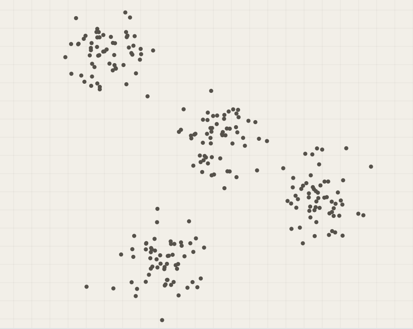

# Watching K-means think

An interactive, scroll-driven explanation of the K-means clustering algorithm,
built from scratch in vanilla JavaScript. No machine-learning libraries and no
chart libraries: the algorithm, the canvas renderer and the charts are all
hand-written.

**Live demo:** https://shohamchakraborty.github.io/kmeans-visualizer/



<!-- TODO: record a ~15s GIF (scroll the story, press Play in the playground,
     switch to Moons) and save it as docs/demo.gif. Tools: ScreenToGif (Windows),
     Kap (macOS), or Peek (Linux). Keep it under ~5 MB so the README loads quickly. -->

## What's on the page

1. **Hero.** A live canvas behind the title: points drift into clusters while
   K-means runs on them in real time, then scatter and start again.
2. **The algorithm in four moves.** A pinned figure that your scroll position
   drives: scatter the points, drop K centroids, assign each point to its nearest
   centroid, move each centroid to the mean and repeat. Scrolling up runs it backwards.
3. **Playground.** Choose K (2 to 8), Random or K-means++ initialisation, and one
   of four datasets. Step through one half-step at a time or press Play, and click
   to add points. The tinted regions show which centroid is nearest everywhere.
4. **Inertia per iteration.** A line chart that follows the playground live.
5. **The elbow.** Inertia for K = 1 to 8 on the current data, with the bend detected
   automatically, and an honest "no clear elbow" when there isn't one.

## How K-means works

K-means splits *n* points into *K* groups so that each point is close to the
centre ("centroid") of its group. It is **unsupervised**: there are no labels,
only positions.

1. **Initialise.** Choose K starting centroids.
2. **Assign.** Give every point to its nearest centroid (straight-line distance).
3. **Update.** Move each centroid to the mean of the points assigned to it.
4. **Repeat** steps 2 and 3 until the centroids stop moving.

**What it minimises.** *Inertia* (also called WCSS, the within-cluster sum of
squares) is the sum of squared distances from each point to its centroid. The
assign step can only lower it (each point picks its closest centroid), and so can
the update step (the mean is the point that minimises squared distance to a group).
So inertia never goes up, and since there are only finitely many ways to split the
points, the algorithm always stops.

**But only at a local minimum.** Where it stops depends on where it started.
Two seeds landing in the same blob can leave the answer stuck. Three standard fixes,
all used on this page:

- **K-means++ initialisation.** Pick each new seed with probability proportional
  to its squared distance from the nearest seed so far, so seeds spread out.
- **Restarts** (`n_init` in scikit-learn). Run several times and keep the result
  with the lowest inertia.
- **Empty-cluster relocation.** If a centroid ends up with no points, move it onto
  the point that is farthest from its own centroid.

**Cost.** Each assign step compares every point with every centroid: O(*nk*) per
iteration. The update step is O(*n* + *k*).

**Where it fails.** The boundary between two centroids is always a straight line
(the perpendicular bisector), so K-means can only carve space into convex regions.
On **Moons** it slices each crescent in half; on **Rings** both rings share one centre,
so distance to a centroid can't separate them. Shapes like these need density-based
(DBSCAN) or graph-based (spectral) clustering instead.

**Choosing K.** Inertia always falls as K grows, so "lowest inertia" can't pick K.
The elbow method looks for the K after which an extra cluster stops buying much.
This page finds the bend as the point farthest below the line joining the first and
last points (the Kneedle idea), measured on log(inertia). It reports a clear elbow
only when the bend is strong. On Uniform data there isn't one, and it says so.

## Project structure

```
src/
  kmeans.js        the algorithm: pure functions, no DOM
  kmeans.test.js   22 tests (run with npm test, or runKmeansTests() in the dev console)
  data.js          seeded dataset generators: blobs, uniform, moons, rings
  renderer.js      canvas drawing, with high-DPI (retina) support
  playground.js    playground state, controls and animation
  charts.js        the inertia and elbow charts, drawn by hand
  scroll.js        Lenis smooth scroll + GSAP ScrollTrigger, and the pinned story
  hero.js          the live hero canvas
  main.js          wires the modules together
  style.css        design tokens, 12-column grid, components
```

Design: an editorial "field notebook" look. Warm paper, near-black ink,
Instrument Serif with JetBrains Mono, hairline rules, and eight muted cluster
inks checked with a colour-vision-deficiency simulator. With `prefers-reduced-motion`,
smooth scrolling is turned off and every animation becomes a simple fade.

## What I learned

<!-- Written as a first draft: edit it into your own words. -->

- **Keep the maths and the pixels apart.** `kmeans.js` has no idea a screen
  exists. Every function takes data and returns new data, so the same five
  functions drive the playground, the scroll story, the hero and the elbow chart,
  and they can be tested in Node.
- **"Converged" doesn't mean "right".** Simulating 400 runs of the hero showed that
  about 1 in 6 got stuck in a local minimum. Adding restarts fixed every one of
  them. Measuring beat guessing.
- **Make animation a function of state.** The scroll story never builds anything
  up; each frame is computed from a handful of progress numbers. Reversing on
  scroll-up came for free.
- **Canvases have two sizes.** The CSS size and the pixel buffer differ by
  `devicePixelRatio`. Matching them is the difference between sharp and blurry
  on a phone.
- **Heuristics need honesty.** The elbow detector always finds *some* bend, so it
  also measures how strong the bend is and says "no clear elbow" when it's weak.

## Run it locally

Requires Node.js 20.19+ or 22.12+.

```bash
npm install
npm run dev       # http://localhost:5173
npm test          # the 22 algorithm tests
npm run build     # production build into dist/
npm run preview   # serve the production build
```

In the dev server's browser console: `runKmeansTests()`, `km.runToConvergence(data.moons(), 2)`,
and `playground.state` are available for poking around.

## Deploy to GitHub Pages

1. Push the project to a GitHub repository named `kmeans-visualizer` (if you use
   another name, change `REPO` in `vite.config.js`).
2. On GitHub: **Settings -> Pages -> Build and deployment -> Source: GitHub Actions**.
3. Push to `main`. The workflow in `.github/workflows/deploy.yml` runs the tests,
   builds, and publishes to `https://<username>.github.io/kmeans-visualizer/`.

## Built with

[Vite](https://vite.dev), [GSAP](https://gsap.com) + ScrollTrigger,
[Lenis](https://lenis.darkroom.engineering), and the HTML Canvas API.
Fonts: [Instrument Serif](https://fonts.google.com/specimen/Instrument+Serif) and
[JetBrains Mono](https://fonts.google.com/specimen/JetBrains+Mono).

---

Shoham Chakraborty · Built from scratch: no ML libraries
